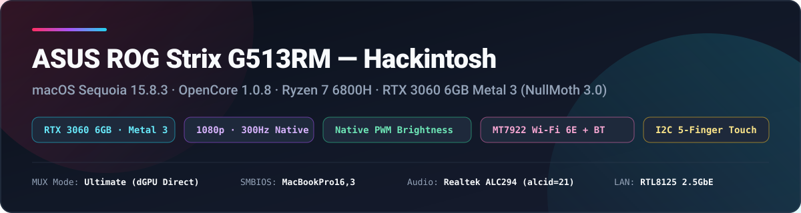
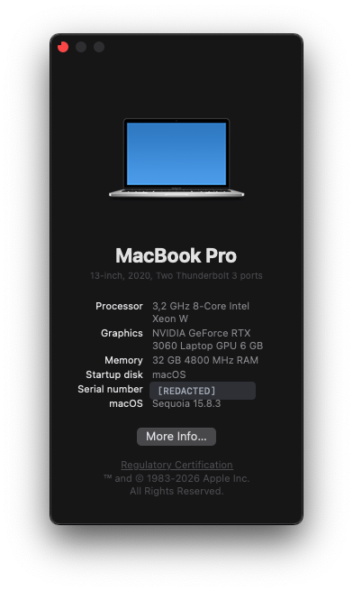
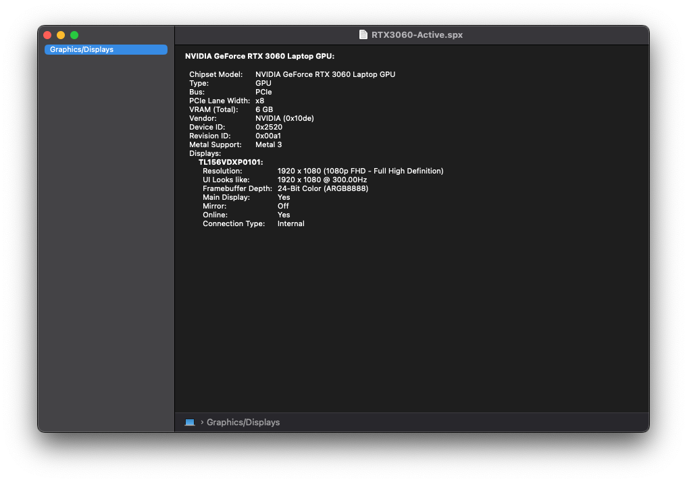
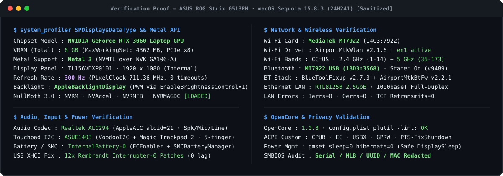

<div align="center">



<p>
  <a href="README.md"></a>
  <a href="README.id.md"></a>
</p>

<p>
  
  
  
  
  
  
</p>

**Referensi konfigurasi & EFI OpenCore 1.0.8 yang bersih dan terverifikasi untuk menjalankan macOS Sequoia 15.8.3 di ASUS ROG Strix G513RM (AMD Ryzen 7 6800H + NVIDIA RTX 3060 6GB via NullMoth 3.0).**

</div>

---

> [!IMPORTANT]
> **SMBIOS & Data Pribadi Sudah Disanitasi:** Seluruh identitas unik perangkat (`SystemSerialNumber`, `MLB`, `SystemUUID`, dan MAC Address Ethernet `ROM`) di `EFI/OC/config.plist` telah diganti dengan placeholder. **WAJIB generate SMBIOS `MacBookPro16,3` milik Anda sendiri menggunakan [GenSMBIOS](https://github.com/corpnewt/GenSMBIOS) sebelum login Apple Account / iCloud.**

---

## Bukti Verifikasi Sistem (Screenshot Asli)

<table>
  <tr>
    <td align="center" width="38%">
      <br>
      <sub><b>About This Mac</b> — RTX 3060 Laptop GPU 6 GB, 32 GB DDR5, macOS Sequoia 15.8.3 (Serial Disensor)</sub>
    </td>
    <td align="center" width="62%">
      <br>
      <sub><b>System Information → Graphics/Displays</b> — Metal 3, VRAM 6 GB, Panel Internal 1920×1080 @ <b>300.00 Hz</b></sub>
    </td>
  </tr>
</table>



Log lengkap hasil verifikasi hardware & driver (yang sudah dibersihkan dari seluruh data pribadi) tersedia di [`assets/verification-log.txt`](assets/verification-log.txt).

> [!NOTE]
> Meskipun di dokumentasi upstream NullMoth NVIDIA 3.0 kartu RTX 20/30/40 masih berstatus eksperimental (dengan RTX 5060 sebagai target validasi utama developer), **repo ini mendokumentasikan validasi fisik nyata RTX 3060 Laptop GPU 6GB (GA106-A) di macOS Sequoia 15.8.3** menggunakan firmware Linux NVIDIA `620.70.06` yang memang di-pin oleh `fw_fetch.sh` NullMoth 3.0.

---

## Spesifikasi Hardware

| Komponen | Model / Detail |
| :--- | :--- |
| **Laptop** | ASUS ROG Strix G513RM (`BIOS G513RM.327`) |
| **CPU** | AMD Ryzen 7 6800H (8C / 16T, Rembrandt, ACPI `\_SB.PLTF.P000..P00F`) |
| **RAM** | 32 GB DDR5 4800 MHz |
| **GPU Aktif** | NVIDIA GeForce RTX 3060 Laptop 6GB (`10DE:2520`, **MUX = Ultimate**) via **NullMoth NVIDIA 3.0** |
| **Layar** | Panel Internal 15.6" FHD (`TL156VDXP0101`, 1920×1080 @ **300 Hz**, PWM backlight) |
| **Wi-Fi / BT** | MediaTek Wi-Fi 6E MT7922 (`14C3:7922` PCIe / `13D3:3568` USB BT) |
| **Ethernet** | Realtek Gaming 2.5GbE (`10EC:8125`, RTL8125B) |
| **Audio** | Realtek ALC294 (`0x10EC0294`) |
| **Touchpad** | ASUS Precision I2C (`HID\ASUE1403` / `\_SB.I2CA.TPD0`) |
| **Keyboard** | ROG N-Key USB (`0B05:19B6`) + PS2 |
| **Storage** | Dual NVMe (Windows 11 + macOS Sequoia 15.8.3 APFS) |
| **SMBIOS** | `MacBookPro16,3` |

---

## Status Fitur (Yang Berjalan & Limitasi)

| Fitur | Status | Detail / Driver |
| :--- | :---: | :--- |
| **RTX 3060 6GB Metal 3** | ✅ Jalan | **NullMoth NVIDIA 3.0** (`NVRM`, `NVAccel`, `NVRMFB`, `NVRMAGDC`), VRAM 6 GB, akselerasi Metal 3 penuh |
| **Layar Internal 300 Hz** | ✅ Jalan | `1920x1080 @ 300 Hz` (`711.36 MHz` pixel clock, 0 frame timeout) |
| **Brightness Hardware & Tombol Fn** | ✅ Jalan | `AppleBacklightDisplay` native aktif lewat `nvregdwords=EnableBrightnessControl=1` + `BrightnessKeys.kext` |
| **Wi-Fi 6E (MT7922)** | ✅ Jalan | `AirportMtkWlan.kext` **v2.1.6** + `DisableIoMapper = true` + `mtk_cc=US -no160` (2.4 GHz & 5 GHz Ch 36–173) |
| **Bluetooth (MT7922 `13D3:3568`)** | ✅ Jalan | `BlueToolFixup` (v2.7.3) + `AirportMtkBtFw` (v2.2.1, `OSBundleRequired=Root`), State: On, Firmware `v9489 c6166` *(JANGAN aktifkan `AirportMtkBtPatcher` di Sequoia — menyebabkan panic IOGMD)* |
| **Ethernet 2.5GbE** | ✅ Jalan | `LucyRTL8125Ethernet.kext` v1.2.400 (1 Gbps Full-Duplex terverifikasi, 0 error/retransmit) |
| **Audio (Speaker / Mic / Jack)** | ✅ Jalan | `AppleALC.kext` v1.9.8 (`alcid=21`, Realtek ALC294) |
| **Touchpad I2C Precision** | ✅ Jalan | `VoodooI2C` + `VoodooI2CHID` + `VoodooInput` (`-vi2c-force-polling`) — gesture 5 jari native Magic Trackpad 2 |
| **USB & Keyboard (Tanpa Lag)** | ✅ Jalan | `USBToolBox` + `UTBMap.kext` custom + **12 patch `Rembrandt XHCI interrupter 0`** |
| **Indikator Baterai** | ✅ Jalan | `ECEnabler.kext` + `SMCBatteryManager.kext` |
| **Restart & Shutdown** | ✅ Jalan | Mati total terverifikasi lewat **`-nvrmnoshutdown`** + patch `FACP` (`0xCF9/0x06`), `SSDT-PTS-FixShutdown`, `SSDT-GPRW`, `DisableRtcChecksum` |
| **Optimasi Fast Boot** | ✅ Jalan | `SetApfsTrimTimeout = 0` (pangkas 4,3 detik TRIM NVMe), `Debug Target = 0`, `APFS HideVerbose = true`, `Timeout = 2s`, boot logo Apple bersih |
| **Display Sleep** | ✅ Jalan | `pmset` aman lewat [`Scripts/fix_sleep.sh`](Scripts/fix_sleep.sh) (`sleep 0`, `hibernatemode 0`, `displaysleep 10/15`) |
| **System Sleep (S3 / S0ix)** | ⚠️ Limitasi Hardware | BIOS G513RM memakai Windows Modern Standby (**S0ix**; `_S3` diubah jadi `XS3`). macOS tidak support S0ix — gunakan Display Sleep |
| **iPhone Mirroring / AirDrop** | ❌ Tidak Support | Membutuhkan chip fisik Apple T2 / Apple Silicon Secure Enclave & kartu Wi-Fi Broadcom AWDL |

---

## Temuan Teknis & Aturan Kritis

### 1. Booter Quirks & MMIO Whitelist Wajib (Ryzen 6800H Rembrandt)
Mematikan `AllowRelocationBlock`, `DevirtualiseMmio`, atau `DisableVariableWrite` langsung menyebabkan hang di `#[EB|LOG:EXITBS:START]`. Ke-4 alamat MMIO Whitelist wajib tetap aktif:
- `0xE0000000` (PCIe ECAM) · `0xFD000000` (AMD PSP) · `0xFEE00000` (Local APIC) · `0xFEE01000` (AMD FCH / NVRAM)

### 2. Mengaktifkan Brightness Hardware PWM di RTX 3060 (`TL156VDXP0101`)
Panel internal 300 Hz milik G513RM (`DPCD 0x701=0x9b`, `0x702=0xa5`) menggunakan jalur **PWM pin**, bukan eDP DPCD AUX brightness. Secara default NVKMS mengembalikan error `0x56` (`NV_ERR_NOT_SUPPORTED`) sehingga macOS hanya mendeteksi `AppleDisplay` tanpa slider brightness.
- **Solusi:** Tambahkan **`nvregdwords=EnableBrightnessControl=1`** ke `boot-args`. `NVRM` NullMoth meneruskan parameter ini ke NVIDIA RM sehingga **`AppleBacklightDisplay`**, slider brightness di System Settings, dan tombol Fn langsung aktif secara native!

### 3. Kext yang WAJIB Tetap Tidak Dipakai
- **`AMDRyzenCPUPowerManagement.kext` & `SMCAMDProcessor.kext`** → **Menyebabkan hard-freeze di Ryzen 6800H Rembrandt!**
- **`WhateverGreen.kext` / kext iGPU AMD** → Tidak boleh aktif saat memakai NullMoth NVIDIA 3.0 di mode MUX Ultimate.
- **`VoodooI2C.kext/Contents/PlugIns/VoodooInput.kext`** → Wajib dimatikan agar tidak bentrok dengan `VoodooInput.kext` milik `VoodooPS2Controller`.
- **`AirportMtkWlan.kext`** → Pertahankan **v2.1.6** untuk stabilitas Sequoia + NullMoth (hindari v2.2.1 Wi-Fi karena konflik dengan NullMoth).
- **`AirportMtkBtPatcher.kext`** → **Wajib tetap dimatikan/dibuang di Sequoia!** Menyebabkan kernel panic `IOGMD` (upstream issue #16/#18). Cukup pakai **`BlueToolFixup.kext` + `AirportMtkBtFw.kext` (v2.2.1 dengan `OSBundleRequired = Root`)** agar Bluetooth & Wi-Fi MT7922 hidup bersamaan.

### 4. Menghilangkan Lag USB 2 Detik & Keyboard Double-Type
Controller XHCI AMD Rembrandt akan mengalami lag USB parah di macOS jika tidak memakai **12 patch `Rembrandt XHCI interrupter 0` (`AppleUSBXHCI`)** yang sudah terpasang lengkap di `EFI/OC/config.plist`.

### 5. Tips Dual-Boot Wi-Fi MT7922
Jika Wi-Fi gagal muncul dengan error `firmware ready poll timed out` setelah reboot dari Windows:
1. **Matikan Fast Startup** di Windows Power Options.
2. Lakukan **cold power drain** (matikan laptop, cabut charger, tahan tombol Power 15–20 detik, lalu nyalakan langsung masuk macOS).

---

## Struktur Repository

```text
.
├── EFI/
│   ├── BOOT/
│   │   └── BOOTx64.efi
│   └── OC/
│       ├── ACPI/          # 5 SSDT custom (CPUR, EC, USBX, GPRW, PTS-FixShutdown)
│       ├── Drivers/       # OpenRuntime, OpenCanopy, HfsPlus, ExFatDxe, ResetNvramEntry
│       ├── Kexts/         # 20 kext aktif bersih (Wi-Fi/BT MT7922, I2C, ALC, RTL8125, dll.)
│       ├── Resources/     # Aset tema GUI OpenCanopy
│       ├── Tools/         # OpenShell.efi
│       ├── OpenCore.efi
│       └── config.plist   # Config OpenCore 1.0.8 ter-sanitasi (SMBIOS kosong)
├── Scripts/
│   ├── fix_sleep.sh       # Konfigurasi pmset aman untuk laptop S0ix
│   └── cek_wifi.sh        # Diagnosa cepat AirportMtkWlan
├── assets/
│   ├── banner.svg
│   ├── about-this-mac.png
│   ├── system-info-rtx3060.png
│   ├── verification-proof.svg
│   └── verification-log.txt
├── README.md              # Dokumentasi Bahasa Inggris
└── README.id.md           # Dokumentasi Bahasa Indonesia
```

---

## Panduan Pemasangan

1. **Pengaturan BIOS / MUX:**
   - Ubah **MUX Switch = Ultimate (dGPU Direct)** lewat Armoury Crate / G-Helper / BIOS.
   - Matikan **Fast Boot** dan **Secure Boot** di BIOS.
   - Matikan **Fast Startup** di Windows agar chip MT7922 tidak terkunci saat dual-boot.
2. **Generate SMBIOS Sendiri:**
   - Buka `EFI/OC/config.plist`, lalu ganti `REPLACE_WITH_GENSMBIOS_MLB`, `REPLACE_WITH_GENSMBIOS_SERIAL`, `REPLACE_WITH_GENSMBIOS_UUID`, dan `ROM` pada bagian `PlatformInfo → Generic` memakai **GenSMBIOS** (`MacBookPro16,3`).
3. **Install NullMoth NVIDIA 3.0 (Tahap 1 → Tahap 2):**
   - Saat instalasi awal / boot pertama *sebelum* NullMoth terpasang, matikan sementara `Kernel → Block → com.apple.iokit.IONDRVSupport`.
   - Setelah masuk macOS Sequoia 15.8.3, install [NullMoth NVIDIA 3.0](https://github.com/nullmoth/nvidia-macos-driver) (dengan firmware driver NVIDIA Linux `620.70.06`), aktifkan kembali block `IONDRVSupport`, lalu reboot.
4. **Terapkan Power Management Aman:**
   ```sh
   sudo sh Scripts/fix_sleep.sh
   ```
5. **Sinkronisasi Jam Dual-Boot (Windows):**
   Tambahkan `RealTimeIsUniversal = 1` (`DWORD`) di `HKLM\SYSTEM\CurrentControlSet\Control\TimeZoneInformation` pada Windows agar jam tidak selisih 7 jam.
6. **Pantau Suhu GPU & CPU (Opsional):**
   Install aplikasi companion **1401 Mac** dari NullMoth untuk memantau suhu, clock, VRAM, dan daya RTX 3060 (serta `NMSMN.kext` untuk telemetry SMU CPU AMD Ryzen). Kecepatan kipas laptop tetap otomatis dikontrol oleh BIOS/EC ASUS.

---

## Credits

- [Acidanthera](https://github.com/acidanthera) — OpenCore, Lilu, VirtualSMC, AppleALC, BlueToolFixup, BrightnessKeys, NVMeFix, RestrictEvents
- [NullMoth Systems](https://github.com/nullmoth/nvidia-macos-driver) — Driver Metal 3 NullMoth NVIDIA 3.0 untuk macOS
- [AMD-OSX](https://github.com/AMD-OSX/AMD_Vanilla) — Patch Kernel AMD Vanilla & Fix XHCI Rembrandt
- [Arxusion / laobamac](https://github.com/Arxusion/AirportMtkWlan) — `AirportMtkWlan` & `SimpleMtkBt` untuk MediaTek MT7922
- [VoodooI2C](https://github.com/VoodooI2C/VoodooI2C) & [USBToolBox](https://github.com/USBToolBox/tool) — Touchpad I2C & USB Mapping
- [Mieze](https://github.com/Mieze/LucyRTL8125Ethernet) — `LucyRTL8125Ethernet`
- [1Revenger1](https://github.com/1Revenger1/ECEnabler) — `ECEnabler`
- [Dortania](https://dortania.github.io/OpenCore-Install-Guide/) — Panduan OpenCore Install & Post-Install
