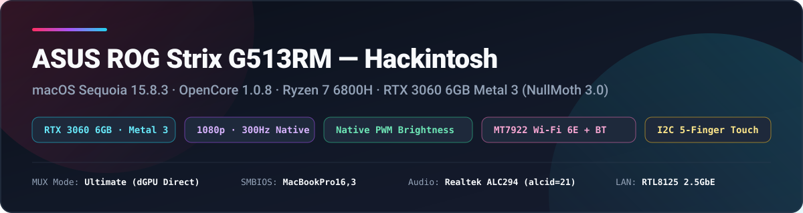
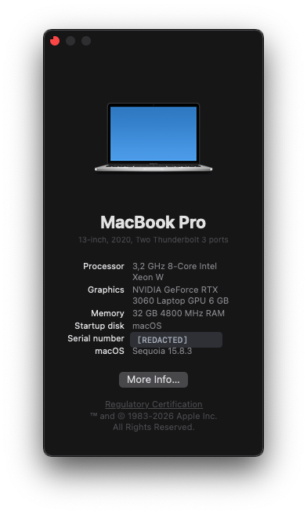
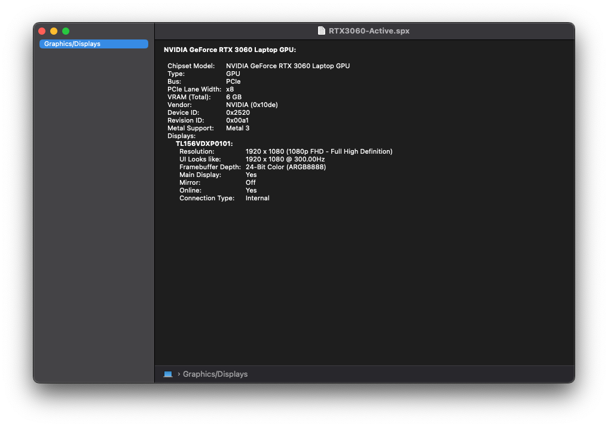
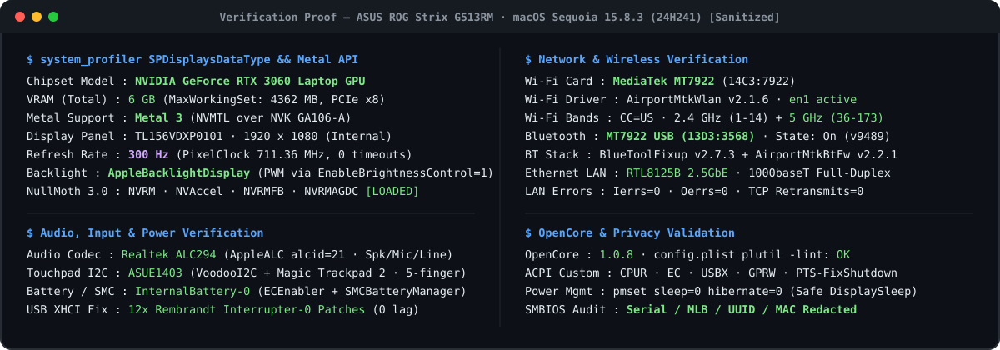

<div align="center">



<p>
  <a href="README.md"></a>
  <a href="README.id.md"></a>
</p>

<p>
  
  
  
  
  
  
</p>

**Clean, sanitized OpenCore 1.0.8 EFI & complete configuration reference for running macOS Sequoia 15.8.3 on ASUS ROG Strix G513RM (AMD Ryzen 7 6800H + NVIDIA RTX 3060 6GB via NullMoth 3.0).**

</div>

---

> [!IMPORTANT]
> **SMBIOS & Privacy Sanitized:** All personal identifiers (`SystemSerialNumber`, `MLB`, `SystemUUID`, and Ethernet MAC `ROM`) have been replaced with placeholders in `EFI/OC/config.plist`. **You MUST generate your own `MacBookPro16,3` SMBIOS using [GenSMBIOS](https://github.com/corpnewt/GenSMBIOS) before signing into Apple Account / iCloud.**

---

## Verification Proof (Real Screenshots)

<table>
  <tr>
    <td align="center" width="38%">
      <br>
      <sub><b>About This Mac</b> — RTX 3060 Laptop GPU 6 GB, 32 GB DDR5, macOS Sequoia 15.8.3 (Serial Redacted)</sub>
    </td>
    <td align="center" width="62%">
      <br>
      <sub><b>System Information → Graphics/Displays</b> — Metal 3, 6 GB VRAM, Internal 1920×1080 @ <b>300.00 Hz</b></sub>
    </td>
  </tr>
</table>



Full sanitized hardware & driver verification outputs are available in [`assets/verification-log.txt`](assets/verification-log.txt).

> [!NOTE]
> While NullMoth NVIDIA 3.0's official upstream qualification matrix lists RTX 5060 as its primary physical validation target and treats RTX 20/30/40 series as experimental, **this repository documents real physical hardware validation of the RTX 3060 Laptop GPU 6GB (GA106-A) on macOS Sequoia 15.8.3** using NullMoth 3.0's pinned NVIDIA Linux firmware `620.70.06` (`fw_fetch.sh`).

---

## Hardware Specifications

| Component | Model / Details |
| :--- | :--- |
| **Laptop** | ASUS ROG Strix G513RM (`BIOS G513RM.327`) |
| **CPU** | AMD Ryzen 7 6800H (8C / 16T, Rembrandt, ACPI `\_SB.PLTF.P000..P00F`) |
| **RAM** | 32 GB DDR5 4800 MHz |
| **GPU (Active)** | NVIDIA GeForce RTX 3060 Laptop 6GB (`10DE:2520`, **MUX = Ultimate**) via **NullMoth NVIDIA 3.0** |
| **Display** | 15.6" Internal FHD (`TL156VDXP0101`, 1920×1080 @ **300 Hz**, PWM backlight) |
| **Wi-Fi / BT** | MediaTek Wi-Fi 6E MT7922 (`14C3:7922` PCIe / `13D3:3568` USB BT) |
| **Ethernet** | Realtek Gaming 2.5GbE (`10EC:8125`, RTL8125B) |
| **Audio** | Realtek ALC294 (`0x10EC0294`) |
| **Touchpad** | ASUS Precision I2C (`HID\ASUE1403` / `\_SB.I2CA.TPD0`) |
| **Keyboard** | ROG N-Key USB (`0B05:19B6`) + PS2 |
| **Storage** | Dual NVMe (Windows 11 + macOS Sequoia 15.8.3 APFS) |
| **SMBIOS** | `MacBookPro16,3` |

---

## Feature Status (What Works & Limitations)

| Feature | Status | Details / Driver |
| :--- | :---: | :--- |
| **RTX 3060 6GB Metal 3** | ✅ Working | **NullMoth NVIDIA 3.0** (`NVRM`, `NVAccel`, `NVRMFB`, `NVRMAGDC`), 6 GB VRAM, full Metal 3 acceleration |
| **300 Hz Internal Display** | ✅ Working | `1920x1080 @ 300 Hz` (`711.36 MHz` pixel clock, 0 frame timeouts) |
| **Hardware Brightness & Fn Keys** | ✅ Working | Native `AppleBacklightDisplay` unlocked via `nvregdwords=EnableBrightnessControl=1` + `BrightnessKeys.kext` |
| **Wi-Fi 6E (MT7922)** | ✅ Working | `AirportMtkWlan.kext` **v2.1.6** + `DisableIoMapper = true` + `mtk_cc=US -no160` (2.4 GHz & 5 GHz Ch 36–173) |
| **Bluetooth (MT7922 `13D3:3568`)** | ✅ Configured | `BlueToolFixup` (v2.7.3) + `SimpleMtkBtPatcher` + `SimpleMtkBtFw` (USB `XHC0/HS02` mapped as Internal `255`) |
| **2.5GbE Ethernet** | ✅ Working | `LucyRTL8125Ethernet.kext` v1.2.400 (1 Gbps Full-Duplex verified, 0 errors/retransmits) |
| **Audio (Speaker / Mic / Jack)** | ✅ Working | `AppleALC.kext` v1.9.8 (`alcid=21`, Realtek ALC294) |
| **I2C Precision Touchpad** | ✅ Working | `VoodooI2C` + `VoodooI2CHID` (`-vi2c-force-polling`) — full 5-finger Magic Trackpad 2 gestures |
| **USB & Keyboard (Zero Lag)** | ✅ Working | `USBToolBox` + custom `UTBMap.kext` + **12x Rembrandt XHCI interrupter-0 kernel patches** |
| **Battery Indicator** | ✅ Working | `ECEnabler.kext` + `SMCBatteryManager.kext` |
| **Restart & Shutdown** | ✅ Configured | `FACP` reset patch (`0xCF9/0x06`), `SSDT-PTS-FixShutdown`, `SSDT-GPRW`, `DisableRtcChecksum`, `-nvrmnoshutdown` |
| **Display Sleep** | ✅ Working | Safe `pmset` via [`Scripts/fix_sleep.sh`](Scripts/fix_sleep.sh) (`sleep 0`, `hibernatemode 0`, `displaysleep 10/15`) |
| **System Sleep (S3 / S0ix)** | ⚠️ Hardware Limit | G513RM BIOS uses Windows Modern Standby (**S0ix**; `_S3` renamed to `XS3`). macOS does not support S0ix — use Display Sleep |
| **iPhone Mirroring / AirDrop** | ❌ Unsupported | Requires physical Apple T2 / Apple Silicon Secure Enclave and native Broadcom AWDL |

---

## Key Technical Breakthroughs & Critical Rules

### 1. Required Booter Quirks & MMIO Whitelist (Ryzen 6800H Rembrandt)
Disabling `AllowRelocationBlock`, `DevirtualiseMmio`, or `DisableVariableWrite` causes an immediate hang at `#[EB|LOG:EXITBS:START]`. The 4 MMIO Whitelist entries are mandatory:
- `0xE0000000` (PCIe ECAM) · `0xFD000000` (AMD PSP) · `0xFEE00000` (Local APIC) · `0xFEE01000` (AMD FCH / NVRAM)

### 2. Unlocking Native PWM Brightness on RTX 3060 (`TL156VDXP0101`)
The G513RM's internal 300 Hz panel (`DPCD 0x701=0x9b`, `0x702=0xa5`) uses a **PWM pin** rather than eDP DPCD AUX brightness. By default, NVKMS returns `0x56` (`NV_ERR_NOT_SUPPORTED`) and falls back to `AppleDisplay` with no brightness control.
- **Fix:** Add **`nvregdwords=EnableBrightnessControl=1`** to `boot-args`. NullMoth `NVRM` passes this registry dword to RM, immediately enabling native **`AppleBacklightDisplay`**, System Settings brightness slider, and Fn brightness keys!

### 3. Kexts That MUST NOT Be Enabled
- **`AMDRyzenCPUPowerManagement.kext` & `SMCAMDProcessor.kext`** → **Hard-freeze on Ryzen 6800H Rembrandt!**
- **`WhateverGreen.kext` / AMD iGPU kexts** → Must remain removed/disabled when running NullMoth NVIDIA 3.0 in MUX Ultimate mode.
- **`VoodooI2C.kext/Contents/PlugIns/VoodooInput.kext`** → Keep disabled to avoid conflict with `VoodooPS2Controller`'s `VoodooInput.kext`.
- **`AirportMtkWlan.kext`** → Stay on **v2.1.6** for Sequoia + NullMoth stability (avoid mixing v2.2.1 Wi-Fi binary with NullMoth).

### 4. Eliminating 2-Second USB Lag & Double-Typing
AMD Rembrandt XHCI controllers cause severe USB latency in macOS without the **12 `Rembrandt XHCI interrupter 0` (`AppleUSBXHCI`) patches** already included in `EFI/OC/config.plist`.

### 5. MT7922 Dual-Boot Cold-Boot Tip
If Wi-Fi fails with `firmware ready poll timed out` after rebooting from Windows:
1. **Disable Fast Startup** in Windows Power Options.
2. Perform a **full power drain** (shutdown, unplug AC adapter, hold Power button 15–20 seconds, then boot straight into macOS).

---

## Repository Structure

```text
.
├── EFI/
│   ├── BOOT/
│   │   └── BOOTx64.efi
│   └── OC/
│       ├── ACPI/          # 5 custom SSDTs (CPUR, EC, USBX, GPRW, PTS-FixShutdown)
│       ├── Drivers/       # OpenRuntime, OpenCanopy, HfsPlus, ExFatDxe, ResetNvramEntry
│       ├── Kexts/         # 20 clean active kexts (Wi-Fi/BT MT7922, I2C, ALC, RTL8125, etc.)
│       ├── Resources/     # OpenCanopy GUI theme assets
│       ├── Tools/         # OpenShell.efi
│       ├── OpenCore.efi
│       └── config.plist   # Sanitized OpenCore 1.0.8 config (SMBIOS redacted)
├── Scripts/
│   ├── fix_sleep.sh       # Safe pmset configuration for S0ix laptops
│   └── cek_wifi.sh        # Quick AirportMtkWlan diagnostics
├── assets/
│   ├── banner.svg
│   ├── about-this-mac.png
│   ├── system-info-rtx3060.png
│   ├── verification-proof.svg
│   └── verification-log.txt
├── README.md              # English Documentation
└── README.id.md           # Dokumentasi Bahasa Indonesia
```

---

## Setup Instructions

1. **BIOS / MUX Setup:**
   - Set **MUX Switch = Ultimate (dGPU Direct)** via Armoury Crate / G-Helper / BIOS.
   - Disable **Fast Boot** and **Secure Boot** in BIOS.
   - Disable **Fast Startup** in Windows (for dual-boot MT7922 stability).
2. **Generate Your Own SMBIOS:**
   - Open `EFI/OC/config.plist` and replace `REPLACE_WITH_GENSMBIOS_MLB`, `REPLACE_WITH_GENSMBIOS_SERIAL`, `REPLACE_WITH_GENSMBIOS_UUID`, and `ROM` under `PlatformInfo → Generic` using **GenSMBIOS** (`MacBookPro16,3`).
3. **Install NullMoth NVIDIA 3.0 (Stage 1 → Stage 2):**
   - For first macOS installation/boot *before* installing NullMoth, temporarily disable `Kernel → Block → com.apple.iokit.IONDRVSupport`.
   - Once inside macOS Sequoia 15.8.3, install [NullMoth NVIDIA 3.0](https://github.com/nullmoth/nvidia-macos-driver) (with NVIDIA Linux driver `620.70.06` firmware), re-enable `IONDRVSupport` block, and reboot.
4. **Apply Safe Power Management:**
   ```sh
   sudo sh Scripts/fix_sleep.sh
   ```
5. **Dual-Boot Clock Sync (Windows Registry):**
   Set `HKLM\SYSTEM\CurrentControlSet\Control\TimeZoneInformation\RealTimeIsUniversal` (`DWORD = 1`) in Windows to prevent the 7-hour UTC clock drift.
6. **GPU & CPU Telemetry (Optional):**
   Install NullMoth's **1401 Mac** companion app to monitor RTX 3060 temperature, clocks, VRAM, and wattage (plus `NMSMN.kext` for AMD Ryzen SMU sensor telemetry). Laptop fan curves remain safely managed automatically by the ASUS EC/BIOS.

---

## Credits

- [Acidanthera](https://github.com/acidanthera) — OpenCore, Lilu, VirtualSMC, AppleALC, BlueToolFixup, BrightnessKeys, NVMeFix, RestrictEvents
- [NullMoth Systems](https://github.com/nullmoth/nvidia-macos-driver) — NullMoth NVIDIA 3.0 Metal 3 driver for macOS
- [AMD-OSX](https://github.com/AMD-OSX/AMD_Vanilla) — AMD Vanilla Kernel Patches & Rembrandt XHCI fixes
- [Arxusion / laobamac](https://github.com/Arxusion/AirportMtkWlan) — `AirportMtkWlan` & `SimpleMtkBt` for MediaTek MT7922
- [VoodooI2C](https://github.com/VoodooI2C/VoodooI2C) & [USBToolBox](https://github.com/USBToolBox/tool) — I2C Touchpad & USB Mapping
- [Mieze](https://github.com/Mieze/LucyRTL8125Ethernet) — `LucyRTL8125Ethernet`
- [1Revenger1](https://github.com/1Revenger1/ECEnabler) — `ECEnabler`
- [Dortania](https://dortania.github.io/OpenCore-Install-Guide/) — OpenCore Install & Post-Install Guides
